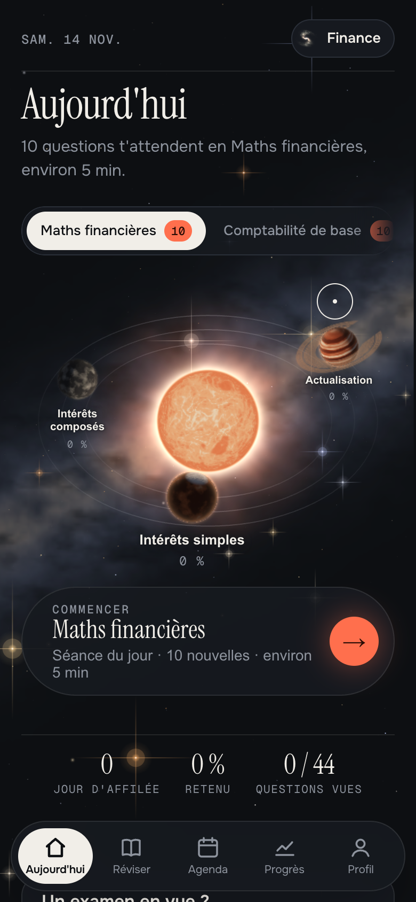
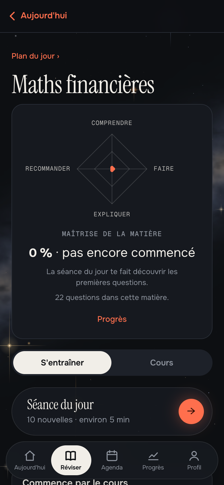
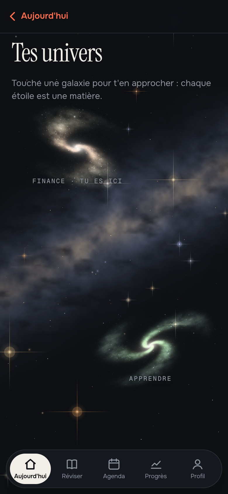

🇬🇧 English version: [README.md](README.md)

# Orrery

**Révise au bon moment, pas avant, pas après.** Orrery est une application de révision par **répétition espacée** (algorithme FSRS-6) qui tourne dans le navigateur, sans compte ni serveur. Le **contenu se change sans toucher au code**, et tu peux importer un cours fait par une IA à partir de tes propres documents.

### [▶ Essayer la démo](https://watilucario.github.io/orrery/)

Pas besoin de savoir utiliser GitHub : ouvre le lien, c'est tout. Un guide s'affiche à la première visite, et [**le guide d'utilisation**](docs/guide-utilisation.md) explique tout pas à pas.

<p align="center">
  
  
  
</p>

## Essayer en trois minutes

1. **Ouvre la démo** et laisse le guide t'accompagner. Tu y crées (en simulation) ton propre univers, puis tu importes un petit cours d'exemple, avec le vrai lecteur de l'app.
2. **Fais une séance du jour.** Réponds, dis si tu étais sûr : c'est ce qui règle la date de la prochaine révision.
3. **Ouvre une matière** : son radar de maîtrise, ses chapitres, fiches illustrées, séries rapides, cas guidé, exercice.

## Ce que contient la démo

Deux univers, quatre matières, tout écrit pour la démonstration (les chiffres sont inventés ou recalculés).

| Univers | Matière | Contenu |
|---|---|---|
| Finance | Maths financières | Intérêts simples et composés, actualisation |
| Finance | Comptabilité de base | Bilan, écritures au journal, résultat |
| Apprendre | Mémoire et révision | Courbe de l'oubli, répétition espacée, rappel actif |
| Apprendre | Statistiques de base | Moyenne et médiane, dispersion, lire un chiffre |

En tout : **92 QCM**, 12 fiches de cours avec schémas, 4 cas guidés et 4 exercices. Les questions prennent toutes les formes : choix multiple, vrai ou faux, trouver l'erreur, associer, ordonner, texte à trous.

## Ce qu'elle fait

- **Deux langues** : l'app et la démo existent en français et en anglais. Un écran « Français · English » te laisse choisir au premier lancement, et tu peux changer plus tard dans Profil › Réglages › Langue.
- **Un ciel à explorer** : chaque univers est une galaxie, chaque matière une étoile, chaque chapitre une planète. Astres et galaxies sont dessinés en temps réel par un petit moteur WebGL écrit à la main, sans bibliothèque ni image.
- **Séance du jour** : les questions sur le point d'être oubliées, plus quelques nouvelles, thèmes mélangés (FSRS-6).
- **Maîtrise en quatre marches** (comprendre, savoir faire, expliquer, recommander), validées par des preuves à plusieurs jours d'écart, résumées dans un radar par matière et par chapitre.
- **Confiance avant correction** : sûr, j'hésite ou au hasard. Une question ratée revient dans la même séance.
- **Rappel libre** : une question déjà réussie en étant sûr revient sans les choix.
- **Fiches de cours illustrées** : encadrés (définition, formule, exemple, piège) et figures (courbes, barres, bilan, écritures).
- **Cas guidés et exercices** : un énoncé résolu en plusieurs étapes, un exercice avec indice et calcul détaillé.
- **Examens** : date et objectif de note ; la séance du jour prépare le prochain examen.
- **Plan du jour** : ce qu'il faut voir, combien, et dans quel ordre, réparti jusqu'à l'examen.
- **Carnet d'erreurs** et liste « À lire avant » un examen.
- **Recherche** dans tous les cours (touche `/` sur ordinateur), **surlignages et notes** sur les fiches, **calculatrice** (Alt+C).
- **Progrès** : réponses, réussite, temps et mémoire du cours, en graphiques.
- **Univers et cours importables** : on décrit un cours à une IA avec un modèle fourni ([`docs/modele-de-pack.md`](docs/modele-de-pack.md)) et on importe le résultat. Aucun fournisseur d'IA n'est obligatoire. Un cours d'exemple prêt à importer est dans [`modeles/exemple-pack.md`](modeles/exemple-pack.md).

## Ce qui se vérifie

- [`tests/fsrs_check.js`](tests/fsrs_check.js) compare 60 000 transitions du moteur à l'implémentation de référence [ts-fsrs](https://github.com/open-spaced-repetition/ts-fsrs), sans aucun écart. Résultat de la dernière exécution : `transitions 60000 mismatches 0`.
- `python3 build.py` valide le contenu avant tout assemblage : une question sans source, une bonne réponse absente ou un identifiant supprimé l'arrêtent avec le fichier et la ligne à corriger.

```bash
cd tests && npm install && node fsrs_check.js
```

## Lancer le projet

Il faut Python 3. Aucune autre dépendance pour l'app.

```bash
python3 build.py
# puis ouvrir dist/standalone.html dans un navigateur
```

Autres assemblages : `dist/moteur/` (le moteur seul, sans contenu) et `dist/maitrise/` (la version vierge : elle démarre sans contenu et te fait créer ton univers pour de vrai).

## Ajouter du contenu

- **Sans écrire de code** : importe un cours dans l'app (Profil › Importer un cours), voir le [guide](docs/guide-utilisation.md#7-importer-un-cours).
- **Dans le projet** : un dossier par matière dans `univers/<programme>/`, avec une `recette.json`, des QCM en Markdown et des fiches. Voir `univers/finance/maths-financieres/` pour un exemple complet et [`univers/README.md`](univers/README.md) pour le format.

## Documentation

| Pour… | Lire |
|---|---|
| Utiliser l'app, sans connaître GitHub | [`docs/guide-utilisation.md`](docs/guide-utilisation.md) |
| Faire écrire un cours par une IA | [`docs/modele-de-pack.md`](docs/modele-de-pack.md) |
| Écrire du contenu à la main | [`univers/README.md`](univers/README.md) |
| Connaître le format d'échange des données | [`docs/format-donnees.md`](docs/format-donnees.md) |
| Comprendre les choix de conception | [`docs/decisions.md`](docs/decisions.md) |

## Limites

- Pas encore testé avec de vrais utilisateurs.
- Un seul auteur, développé avec des agents IA (Claude Code) : tests, garde-fous et relecture ont servi à cadrer leur travail.
- Le contenu de démo est écrit pour la démonstration : ce n'est pas un cours à apprendre pour un examen.
- Ce dépôt public ne contient que le moteur, la documentation et un contenu de démo. La suite de tests complète (parcours dans le navigateur) et le contenu de cours de l'auteur restent dans un dépôt privé : seul le contrôle FSRS est publié ici.
- La création d'un univers qui reste se fait dans la version vierge (`dist/maitrise/`) : dans la démo en ligne, le guide la simule sans rien enregistrer.
- Pas de synchronisation entre appareils dans cette version : la progression se sauvegarde dans un fichier.

## Licence

Code : MIT. Contenu de démo : CC BY-SA 4.0. Voir [`NOTICE.md`](NOTICE.md).
