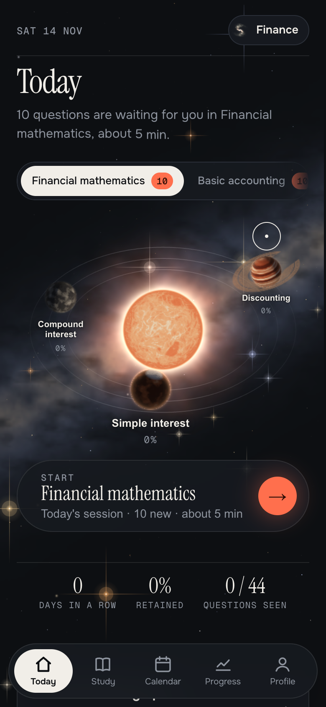
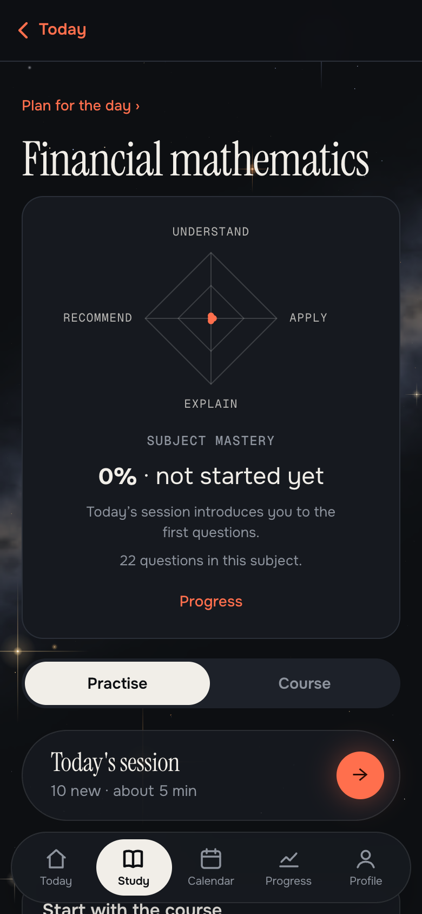
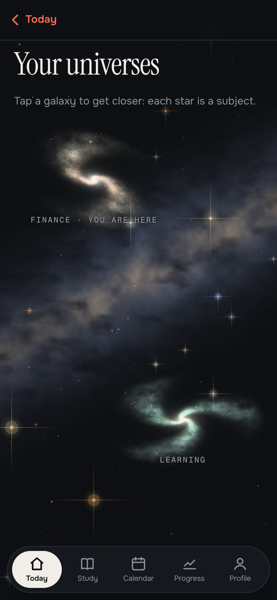

🇫🇷 Version française : [README.fr.md](README.fr.md)

# Orrery

**Review at the right moment: not too early, not too late.** Orrery is a study app built on **spaced repetition** (the FSRS-6 algorithm). It runs in your browser, with no account and no server. The **content can be changed without touching the code**, and you can import a course that an AI made from your own documents.

### [▶ Try the demo](https://watilucario.github.io/orrery/)

You don't need to know how to use GitHub: open the link, that's all. A guide appears on your first visit, and [**the user guide**](docs/user-guide.md) explains everything step by step.

<p align="center">
  
  
  
</p>

## Try it in three minutes

1. **Open the demo** and let the guide walk you through. You create your own universe (as a simulation), then import a small sample course, using the app's real reader.
2. **Do a daily session.** Answer, and say how sure you were: that sets the date of your next review.
3. **Open a subject**: its mastery radar, its chapters, illustrated course sheets, quick sets, a guided case, an exercise.

## What the demo contains

Two universes, four subjects, all written for the demonstration (the numbers are made up or recalculated).

| Universe | Subject | Content |
|---|---|---|
| Finance | Financial mathematics | Simple and compound interest, discounting |
| Finance | Basic accounting | Balance sheet, journal entries, profit |
| Learning | Memory and revision | Forgetting curve, spaced repetition, active recall |
| Learning | Basic statistics | Mean and median, spread, reading a figure |

In total: **92 multiple-choice questions**, 12 course sheets with diagrams, 4 guided cases and 4 exercises. Questions come in every form: multiple choice, true or false, find the mistake, match, put in order, fill in the blanks.

## What it does

- **Two languages**: the app and the demo exist in French and in English. A "Français · English" screen lets you choose on first launch, and you can change it later in Profile › Settings › Language.
- **A sky to explore**: each universe is a galaxy, each subject a star, each chapter a planet. Stars and galaxies are drawn in real time by a small hand-written WebGL engine, with no library and no image.
- **Daily session**: the questions you are about to forget, plus a few new ones, with topics mixed (FSRS-6).
- **Mastery in four steps** (understand, apply, explain, recommend), each confirmed by evidence spread over several days and summed up in a radar for each subject and each chapter.
- **Confidence before the answer is shown**: sure, hesitating or a guess. A question you miss comes back in the same session.
- **Free recall**: a question you already got right while sure comes back without the choices.
- **Illustrated course sheets**: boxes (definition, formula, example, pitfall) and figures (curves, bars, balance sheet, journal entries).
- **Guided cases and exercises**: a problem solved in several steps, and an exercise with a hint and a detailed calculation.
- **Exams**: a date and a target grade; the daily session prepares for the next exam.
- **Daily plan**: what to study, how much, and in what order, spread out until the exam.
- **Mistake notebook** and a "To read before" list for an exam.
- **Search** across all courses (the `/` key on a computer), **highlights and notes** on the sheets, a **calculator** (Alt+C).
- **Progress**: answers, success rate, time and course memory, shown in charts.
- **Importable universes and courses**: you describe a course to an AI with a provided template ([`docs/modele-de-pack.en.md`](docs/modele-de-pack.en.md)) and import the result. No AI provider is required. A sample course ready to import is in [`modeles/exemple-pack.en.md`](modeles/exemple-pack.en.md).

## What is checked

- [`tests/fsrs_check.js`](tests/fsrs_check.js) compares 60,000 transitions of the engine with the reference implementation [ts-fsrs](https://github.com/open-spaced-repetition/ts-fsrs), with no difference at all. Result of the last run: `transitions 60000 mismatches 0`.
- `python3 build.py` checks the content before building anything: a question with no source, a missing right answer or a deleted identifier stops it, with the file and line to fix.

```bash
cd tests && npm install && node fsrs_check.js
```

## Run the project

You need Python 3. The app has no other dependency.

```bash
python3 build.py
# then open dist/standalone.html in a browser
```

Other builds: `dist/moteur/` (the engine alone, with no content) and `dist/maitrise/` (the blank version: it starts with no content and has you create your universe for real).

## Add content

- **Without writing code**: import a course in the app (Profile › Import a course), see the [guide](docs/user-guide.md#7-import-a-course).
- **In the project**: one folder per subject in `univers/<programme>/`, with a `recette.json`, multiple-choice questions in Markdown and course sheets. See `univers/finance/maths-financieres/` for a complete example and [`univers/README.en.md`](univers/README.en.md) for the format.

## Documentation

| To… | Read |
|---|---|
| Use the app, without knowing GitHub | [`docs/user-guide.md`](docs/user-guide.md) |
| Have an AI write a course | [`docs/modele-de-pack.en.md`](docs/modele-de-pack.en.md) |
| Write content by hand | [`univers/README.en.md`](univers/README.en.md) |
| Know the data exchange format | [`docs/format-donnees.en.md`](docs/format-donnees.en.md) |
| Understand the design choices | [`docs/decisions.en.md`](docs/decisions.en.md) |

## Limits

- Not yet tested with real users.
- A single author, built with AI agents (Claude Code): tests, safeguards and review were used to keep their work on track.
- The demo content is written for the demonstration: it is not a course to learn for an exam.
- This public repository only contains the engine, the documentation and demo content. The full test suite (browser walkthroughs) and the author's own course content stay in a private repository: only the FSRS check is published here.
- Creating a universe that stays is done in the blank version (`dist/maitrise/`): in the online demo, the guide simulates it and saves nothing.
- No sync between devices in this version: your progress is saved to a file.

## License

Code: MIT. Demo content: CC BY-SA 4.0. See [`NOTICE.md`](NOTICE.md).
